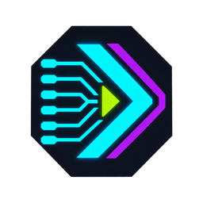

# DLSS Nexus

**A simpler way to set up and manage DLSS 5 injection on Windows.**

DLSS Nexus brings community DLSS 5 / Neural Rendering add-ons, ReShade and optional DLSS5 Feeder support together in a guided setup app and game library. It helps you choose the right setup, review the files going into each game, keep track of installed components and launch your games from one place.

Instead of manually matching add-ons, copying runtimes and managing presets for every game, Nexus handles the setup and backups. The upstream add-ons and Feeder provide the injection technology when the game runs; Nexus makes them easier to install and manage.

## What it helps with

- **Set up DLSS 5 injection** for suitable DirectX 11 and DirectX 12 games, with a beta Feeder route for 64-bit DirectX 10 games.
- **Choose native DLSS or Feeder**, depending on whether the game already includes DLSS.
- **Review changes before installing**, including which files will be installed, replaced or kept. Replaced files are backed up for recovery.
- **Track your game library**, with installed DLSS, ReShade and add-on versions alongside your in-game feature settings.
- **Launch games directly** from the library or the Ready screen after installation.

## Two ways to set up a game

### Games with native DLSS

If DLSS is already available in the game's graphics settings, Nexus can set up the Neural Rendering add-on using that native support. It prepares ReShade's shader files and a Nexus preset with effects disabled, without installing the Feeder add-on. Enable DLSS in the game, then configure Neural Rendering in the add-on panel.

Switching from Feeder? Review offers **Turn off Feeder for this setup**. Nexus backs up the active preset, disables its Feeder effect and keeps your other effects and settings when you install.

### Games without native DLSS

The optional **[DLSS5 Feeder](https://github.com/jlrouzies-fr/DLSS5-Feeder)** route supplies frame data through ReShade so compatible games without built-in DLSS can use the Neural Rendering add-on. Nexus installs the Feeder components and preset; you finish by selecting the game's scene-depth buffer and configuring the add-on in ReShade.

**DirectX 10 uses a different setup.** Nexus installs Feeder's 64-bit helper and puts its ReShade, Generic neural add-on and runtimes in a local `host64` folder. The default DX10 add-on is Generic v7.0.0-rc8; the existing Legacy v4.7 option is unchanged. This beta route works at native resolution (DLAA), and its neural controls are in the helper panel rather than the game's ReShade panel.

This is not a universal upgrade for every game. Compatibility depends on the game, graphics API, GPU, driver and add-on. Nexus sets up Neural Rendering; it does not automatically add Super Resolution, Ray Reconstruction or Frame Generation to games that do not support those features.

## Included injection payloads

DLSS Nexus **1.0.0** includes the following components:

| Component | Version | Date | Used for |
|---|---|---|---|
| DLSS5 Feeder and matched `DLSS5_Feed.fx` | 1.19.0 | [11 October 2026](https://github.com/jlrouzies-fr/DLSS5-Feeder/releases/tag/v1.19.0) | Feeder setup |
| Feeder DX10 helper and `host64` executable | 1.19.0 | 11 October 2026 | DX10 Feeder setup |
| ShortFuse `renodx-dlss.addon64` | `0.2026.1016.1704` | 16 October 2026 | Standard DX11/DX12, including native DLSS |
| RenoDX Generic `renodx-dlss5.addon64` | v7.0.0-rc8 | [23 September 2026](https://github.com/RankFTW/rhi-repo/releases/tag/renodx-dlss5-7.0.0-rc8) | Standard DX10 helper |
| Legacy RenoDX Generic `renodx-dlss5.addon64` | v4.7 | [1 September 2026](https://github.com/RankFTW/rhi-repo/releases/tag/renodx-dlss5-4.70) | Optional Legacy profile |
| DLSS Super Resolution `nvngx_dlss.dll` | `310.8.0.0` · NVIDIA-signed | [27 August 2026](https://github.com/RankFTW/rhi-repo/releases/tag/dlss-310.8.0) | Feeder setup; existing game runtime kept |
| DLSS Neural Rendering `nvngx_dlssnr.dll` — ShortFuse compatibility build | `310.9.16.0` · patched FP16 · **unsigned** | 16 October 2026 | Neural Rendering support for RTX 20/30/40 series |
| LumeniteFX `lumenite_Kernel.fx` | `2026.07.28` | 28 July 2026 | Feeder motion-vector preset |

**Custom — testing** includes the same ShortFuse build as Standard and lets you select a different add-on. **ReShade is downloaded when needed.** Review and Check status show the component versions installed for each game.

See **[included files and checksums](docs/SAFETY.md#package-components)** for the full component list and setup details.

## Download and get started

**[Download the Windows installer or portable ZIP →](https://github.com/daemosofchaos/dlss-nexus/releases/latest)**

Both include the .NET runtime—no separate .NET installation is needed.

1. Close the game and open **DLSS Nexus**.
2. Select it in **All games**, or use **Add game…** to choose its folder or executable.
3. Choose **Set up**, answer whether the game has native DLSS and review the file changes.
4. Install, then finish the in-game configuration using the **[getting-started guide](docs/GETTING-STARTED.md)**.

**Requirements:** Windows 10/11, a 64-bit game and a compatible NVIDIA GPU and driver. Native-DLSS setup supports DX11/DX12; Feeder setup also offers DX10 (beta). Static API detection is a hint—if the game can switch APIs or uses dynamic loading, choose its active DirectX version under **Advanced**.

**RTX 20, 30 and 40 series support:** Nexus includes ShortFuse's patched FP16 DLSS Neural Rendering runtime, providing Neural Rendering compatibility for these GeForce RTX generations.

> **Use only with suitable single-player games, never with anti-cheat.** The app and bundled neural runtime are unsigned.

## Your game library

**All games** lists detected installs; **Tracked** lists games you have checked or configured. Use **Check status** to refresh installed versions, and **Record in-game settings** to save your Super Resolution, Ray Reconstruction, Frame Generation and Neural Rendering settings.

“Installed” confirms component files, not active rendering. Feature settings are your local reports, not live telemetry; file or configuration changes mark those reports for rechecking.

**Launch game** starts the recorded executable. Games requiring launcher sign-in or custom launch options should still be started through their usual launcher.

## Credits

Nexus builds on the work of these projects and creators:

- **[DLSS5 Feeder](https://github.com/jlrouzies-fr/DLSS5-Feeder)** — **Jean-Laurent Rouzies (jlrouzies-fr)** and contributors, for the optional Feeder injection support. Its bridge work also credits **[NIGos](https://github.com/NIGos/dlss5-dx11-bridge)**.
- **[RenoDX / ShortFuse](https://github.com/clshortfuse/renodx)** — **ShortFuse (clshortfuse)** and the RenoDX contributors, for the Standard DLSS add-on and underlying modding framework. ShortFuse also provides the patched DLSS-NR runtime for RTX 20, 30 and 40 series cards.
- **Generic DLSS5 add-ons** — **Krish** and the **[RenoDX community](https://discord.gg/F6AUTeWJHM)**, for the Generic builds. The DX10 build is supplied through **[RHI / RankFTW](https://github.com/RankFTW/rhi-repo/releases/tag/renodx-dlss5-7.0.0-rc8)**, the provider referenced by Feeder's installer.
- **[ReShade](https://reshade.me/)** — **Patrick Mours (crosire)** and contributors, for the graphics-injection and add-on framework.
- **[LumeniteFX](https://github.com/umar-afzaal/LumeniteFX)** — **Umar Afzaal / Afzaal (Kaidō)**, for the included kernel and shader assets.
- **NVIDIA** — for DLSS technology and the original runtime components.

Credit for these technologies belongs to their creators. See **[Third-party notices](THIRD-PARTY-NOTICES.md)** for licenses, attribution and distribution terms.

## License

DLSS Nexus's own source code is licensed under the **[MIT License](LICENSE)**.

Third-party add-ons, shaders and runtimes retain their own licenses and distribution terms. The MIT license for Nexus does not grant additional rights to those components; see [Third-party notices](THIRD-PARTY-NOTICES.md).

## Help and development

[Compatibility and recovery](docs/SAFETY.md) · [Build and test](app/BUILD.md) · [Solution](app/Nexus.sln) · [Installer](build/Nexus.iss)

DLSS Nexus is an independent third-party app. It is not affiliated with or endorsed by NVIDIA or the upstream projects.
